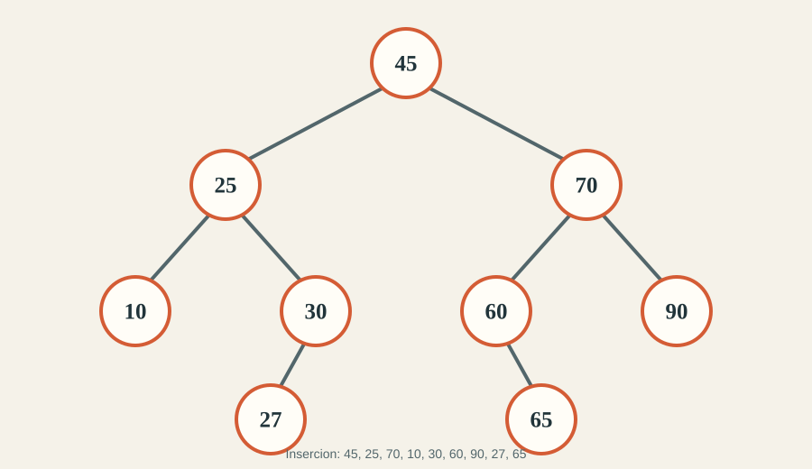
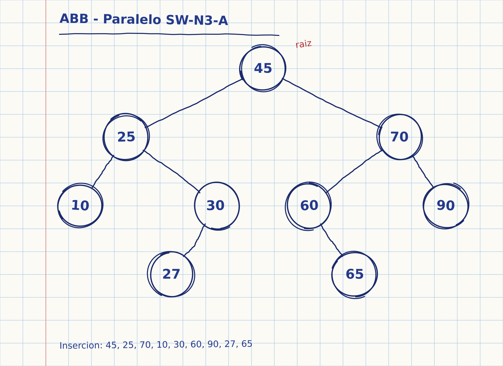

# Reto: recorridos en un arbol binario de busqueda

Solucion en Java del reto **SW-N3-A**. Inserta los valores en el orden indicado, representa el arbol resultante, calcula los tres recorridos y muestra como trabajan las llamadas recursivas.

## 1. Datos e insercion

El arbol empieza vacio. Se insertan, en este orden:

```text
45, 25, 70, 10, 30, 60, 90, 27, 65
```

En un arbol binario de busqueda (ABB), un valor menor que el nodo actual se busca por la izquierda y uno mayor por la derecha. La insercion queda asi:

| Valor | Ubicacion |
| ---: | --- |
| 45 | Raiz |
| 25 | Izquierda de 45 |
| 70 | Derecha de 45 |
| 10 | Izquierda de 25 |
| 30 | Derecha de 25 |
| 60 | Izquierda de 70 |
| 90 | Derecha de 70 |
| 27 | Izquierda de 30 |
| 65 | Derecha de 60 |

### Arbol resultante



### Evidencia del trabajo a mano

Foto original del arbol dibujado a mano para el reto:



## 2. Recorridos

Los recorridos se obtienen visitando cada nodo en un orden distinto:

| Recorrido | Regla | Resultado |
| --- | --- | --- |
| Preorden | Raiz, izquierda, derecha | `45, 25, 10, 30, 27, 70, 60, 65, 90` |
| Inorden | Izquierda, raiz, derecha | `10, 25, 27, 30, 45, 60, 65, 70, 90` |
| Posorden | Izquierda, derecha, raiz | `10, 27, 30, 25, 65, 60, 90, 70, 45` |

El inorden de un ABB produce los valores ordenados de menor a mayor. La raiz aparece primero en preorden y al final en posorden.

## 3. Metodos recursivos y traza

El programa esta en [`src/ABBRecorridos.java`](src/ABBRecorridos.java). La clase `Nodo` guarda el dato y las referencias `izq` y `der`. El metodo `insertar` compara el valor con el nodo actual y se llama recursivamente por un solo hijo; si llega a `null`, crea el nuevo nodo. Si el valor ya existe, no modifica el arbol.

Los tres metodos de recorrido siguen la misma estructura: si el nodo es `null`, imprimen `null -> regresa` y terminan esa llamada. Si existe, imprimen `entra <dato>` y ejecutan las llamadas recursivas. La posicion de `VISITA <dato>` determina el recorrido:

| Metodo | Momento de `VISITA` |
| --- | --- |
| `preorden` | Antes de recorrer los hijos |
| `inorden` | Entre el recorrido izquierdo y el derecho |
| `posorden` | Despues de recorrer ambos hijos |

La traza de inorden empieza asi. La sangria de `entra` y `null` indica la profundidad de la llamada:

```text
entra 45
  entra 25
    entra 10
      null -> regresa
VISITA 10
      null -> regresa
VISITA 25
    entra 30
      entra 27
        null -> regresa
VISITA 27
        null -> regresa
VISITA 30
      null -> regresa
VISITA 45
```

El programa imprime la traza completa de los tres recorridos, no solo este fragmento.

## 4. Casos limite

El programa tambien muestra estos casos al final de la ejecucion:

| Caso | Preorden | Inorden | Posorden | Observacion |
| --- | --- | --- | --- | --- |
| Arbol vacio | `[]` | `[]` | `[]` | No visita nodos. La traza del recorrido imprime `null -> regresa`. |
| Un nodo: `10` | `10` | `10` | `10` | Los tres recorridos coinciden. |
| Cadena: `10, 20, 30, 40` | `10, 20, 30, 40` | `10, 20, 30, 40` | `40, 30, 20, 10` | Queda degenerado hacia la derecha; su altura en niveles es 4. |
| Repetido: `30, 30` | `30` | `30` | `30` | La implementacion ignora duplicados. |

Si se quisiera permitir duplicados, habria que definir una regla consistente, por ejemplo insertar los iguales siempre a la derecha. En esta solucion se elige ignorarlos.

## Ejecutar

Se necesita un JDK instalado. El codigo evita depender de caracteristicas posteriores a Java 8.

Desde la carpeta raiz del repositorio:

```bash
javac -encoding UTF-8 -d out src/ABBRecorridos.java
java -cp out ABBRecorridos
```

La salida muestra primero el arbol, luego las listas de recorridos, las trazas recursivas completas y los casos limite.